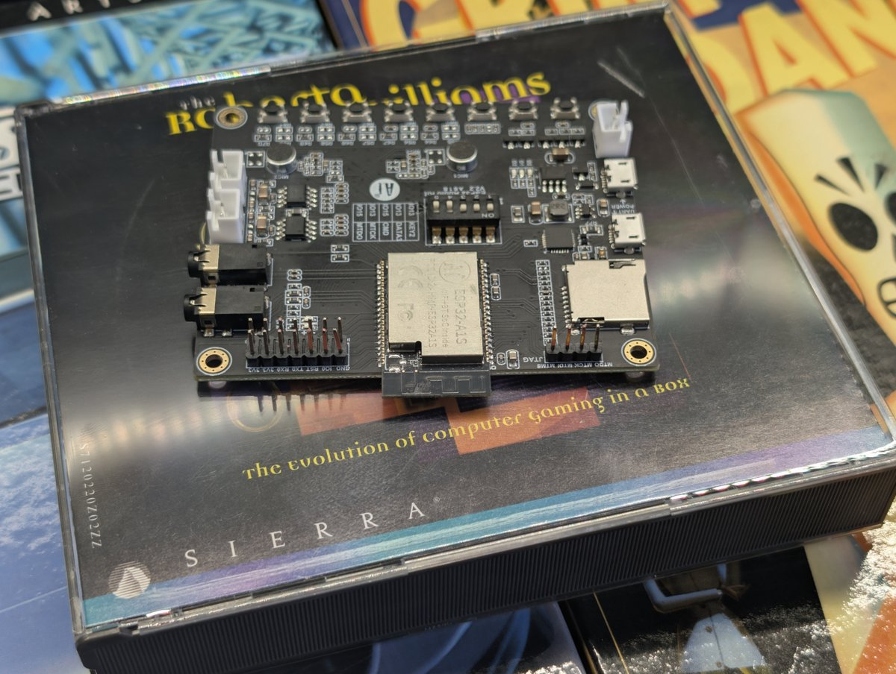
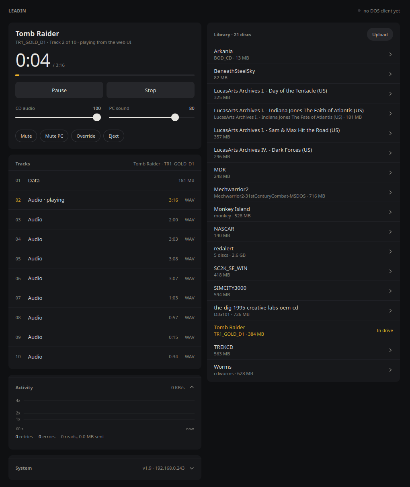

# LEADIN: a network CD-ROM server for DOS PCs


LEADIN is a firmware for the Ai-Thinker ESP32 Audio Kit V2.2. It turns the board into a stand-alone CD-ROM server for DOS over Wi-Fi. It plays the CD audio tracks on its headphone jack, and mixes in the DOS PC's sound from its LINE IN jack.

The DOS PC runs [LEADOUT](https://github.com/andreacampanella/LEADOUT), the matching client. LEADOUT is a CD-ROM device driver for DOS: it finds the board and transfers the CD data over Wi-Fi. CD audio does not cross the network. The board plays it, and the PC sends only the play, stop and volume commands.

Games are none the wiser.

## But Why?

LEADIN serves a very niche purpose: I have a DOS industrial computer without a CD-ROM drive and no space for one, but I want to play CD-based games on it.

## What you need



- Ai-Thinker ESP32 Audio Kit V2.2 with the ES8388 codec (the chip next to the audio jacks says ES8388)
- a microSD card, formatted FAT32
- a micro-USB cable, in the port marked "UART"
- two 3.5 mm stereo cables: DOS sound card LINE OUT to the board's LINE IN, and the board's EARPHONES jack to your speakers

Set the DIP switches for **CMD** and **DATA3** to ON. The SD card shares these pins with KEY2 and the JTAG header, so KEY2 and JTAG do not work.

## Prepare the SD card

1. Format the card FAT32.
2. Create `LEADIN.CFG` in the root of the card:
   ```
   SSID=YourNetwork
   PASSWORD=YourPassword
   ```
3. Copy your images to the card: `.iso` files, `.cue` files with their `.bin` files, or `.mds` files with their `.mdf` (Alcohol 120%). Subfolders are fine, for example one folder for each game. Folders whose name starts with a dot are ignored.

### LEADIN.CFG keys

| Key | Default | Meaning |
|-----|---------|---------|
| `SSID` | (none) | Your Wi-Fi network |
| `PASSWORD` | (none) | Its password. Leave it out for an open network |
| `HOSTNAME` | `leadin` | Name on the network. The web UI is at `http://<hostname>.local/` |
| `LINE_LEVEL` | `30` | Headphone output level, 0 to 33. 30 = 0 dB, about line level. Lower it if the sound card's input distorts |
| `I2S_WS`, `I2S_DOUT` | `25`, `26` | The I2S word clock and data pins. Some batches need `I2S_WS=26` and `I2S_DOUT=25`. The log line `I2S: ...` shows the pins in use |

Without `SSID`, or if the board cannot connect within 60 seconds, it starts an open access point **LEADIN-SETUP**. Join it with a phone, open `http://192.168.4.1/`, and enter your network. The board writes `LEADIN.CFG` and restarts.

## Flash the board

The release folder has these files:

| File | Use |
|------|-----|
| `leadin-audiokit-full.bin` | The whole flash in one file, for a new board |
| `leadin.bin` | The application only, for the firmware update in the web UI |
| `FLASH.TXT` | The flash steps |

Flash a new board with esptool:

```
esptool.py --chip esp32 -p /dev/ttyUSB0 -b 460800 write_flash 0x0 leadin-audiokit-full.bin
```

If the board does not answer, press and hold the BOOT key while esptool connects.

## Build

The Makefile works on Ubuntu and on CachyOS.

```
make deps          # system packages, once (uses sudo)
make setup         # ESP-IDF 5.4.1, once (about 2.4 GB, in ~/.leadin-tools)
make               # the firmware for every board, into dist/
make flash         # PORT=/dev/ttyUSB0 if the port is not found
make monitor
make release       # dist/leadin-<version>.zip
```

`make help` lists all targets. ESP-IDF 5.4 needs Python 3.10 to 3.13 for its own build scripts. If the system has only a newer Python, `make setup` uses uv to get Python 3.13 for ESP-IDF only.

To use an ESP-IDF that you have already, give `IDF=~/esp/esp-idf IDF_TOOLS=~/.espressif`.

### The layers

| Layer | Folder | Contents |
|-------|--------|----------|
| core | `main/` | LEADIN protocol, image reader, library, audio player, web UI, LEDs. No pins. |
| drivers | `components/leadin_hal/` | One file for each kind of hardware: codec, SD card, LEDs, wired network. `hal.h` is the interface. |
| boards | `boards/<name>/` | `board.c` with the pins and the drivers, and `sdkconfig.board` with the chip settings. |

See `boards/README.md` to add a board.

The mDNS component is in `components/mdns` (from espressif/esp-protocols), so the build downloads no component. The web UI is `main/webui.html`, embedded at build time.

## First test on the board

1. **Boot log.** Run `make monitor`. Look for `ES8388 found on I2C SDA .., SCL ..`, `I2S: ...` and `SD card: ...`.
2. **Wi-Fi.** Look for `Network up: <address>`. Open `http://leadin.local/` or the address.
3. **CD audio.** In the web UI, insert a disc with audio tracks and click Play. You should hear it on the EARPHONES jack. If the codec is found but the jack stays silent, put `I2S_WS=26` and `I2S_DOUT=25` in `LEADIN.CFG`.
4. **Mixer.** Connect the DOS sound card's LINE OUT to the board's LINE IN. Move the "PC sound" slider. If the PC's sound is faint or thin while the CD music is fine, open **System** and try the other "PC sound input" pair.
5. **DOS.** Run `C:\LEADOUT\MOUNT`, then `DIR F:`, then a game.

## Web UI



Everything goes through the web interface, a sleek, clean, easy-to-read page where you can select your CDs, get statistics about the server, stop and start the music (you can use it as a networked CD audio player if you are so inclined), upload images (if you really want to, it's slow) and much more!

### API

| Method | Path | Body or query | Does |
|--------|------|---------------|------|
| GET | `/api/state` | | All state as JSON |
| POST | `/api/select` | `{"name": "<path>"}`, or `{"name": null}` to eject | Change the disc |
| POST | `/api/audio` | `{"action": "play", "track": n}`, `pause`, `resume`, `stop` | Control the music |
| POST | `/api/volume` | any of `volume` (0..100), `mute`, `override`, `client_timeout`, `pc_volume`, `pc_mute`, `pc_input` (1 or 2, 0 = board default) | Change settings |
| GET | `/api/export?track=n` | | A track as a WAV file |
| PUT | `/api/upload?name=<file>&overwrite=1` | the file | Upload to the card's root |
| POST | `/api/system` | `{"ota_enabled": true}`, `{"light_theme": true}` | The firmware update switch (not kept), the web UI theme (kept) |
| POST | `/api/firmware` | the `leadin.bin` file | Firmware update (403 while the switch is off) |

### Firmware update

1. In the web UI, open **System** and turn on **Firmware update**. The switch is off after every restart, so nobody replaces the firmware by mistake.
2. Click **Choose leadin.bin** and pick the `leadin.bin` of the new release.
3. The board checks the file. It refuses a file that is not a LEADIN image, or one built for another board. Then it writes the file to the other flash slot and restarts.

The new firmware confirms itself once the web UI is up. If it fails before that, the next start goes back to the old firmware.

From a shell, after you turn the switch on:

```
curl -X POST -H 'Content-Type: application/json' -d '{"ota_enabled":true}' http://leadin.local/api/system
curl --data-binary @leadin.bin http://leadin.local/api/firmware
```

## Settings

The board keeps these in its flash (NVS), so they survive a restart: the last disc, the music volume, mute, music override, the client timeout, the PC sound level, its mute and its input pair, and the web UI theme. The firmware update switch is not kept.

## Client liveness

When a DOS game starts the music, LEADOUT sends a heartbeat every 5 seconds. If the board hears nothing from that PC for the client timeout (15 seconds by default, set in the web UI), it stops the music. Music started from the web UI is never stopped this way. See `PROTOCOL.md`, "Client liveness".

## LEDs

D4 and D5, next to the headphone jack, are status LEDs. Both are on for one second at start, as a test. D4 is the network: it blinks while the board connects or runs the setup access point, stays on when the network is up, and flickers with each read from DOS. D5 is the audio: on while a track plays, blinking while paused. D1 to D3 near the USB ports belong to the power circuit and cannot be switched off.

## Known limits

- Wi-Fi is 2.4 GHz only (the ESP32 has no 5 GHz).
- Upload over Wi-Fi is slow. Copying images to the card in a PC is faster.
- The card must be FAT32. Files must be smaller than 4 GB (CD images always are).
- MDF/MDS: CD images only, no DVD. The `.mdf` must have the same name as the `.mds`. Images with subchannel data (2448-byte sectors) work, but read slower.
- The web UI has no password. Anyone on your network can use it. The firmware update switch limits the damage.
- A disc change from the web UI appears in DOS after SHSUCDX's 7-second idle check, as with a real drive. `LEADOUT /DISC` shows it at once.

## Licences

| Component | Licence |
|-----------|---------|
| ESP-IDF, including FreeRTOS (MIT), lwIP (BSD), FatFs (BSD-style), cJSON (MIT) | Apache 2.0 |
| mDNS (`components/mdns`, from espressif/esp-protocols) | Apache 2.0 |
